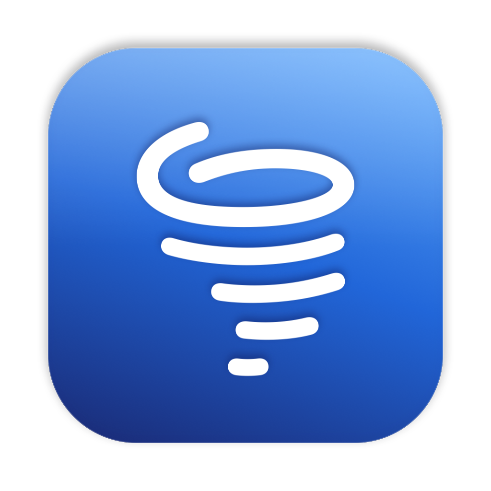
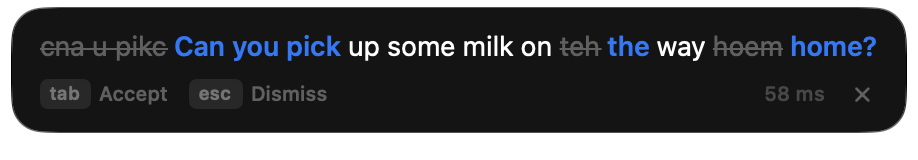
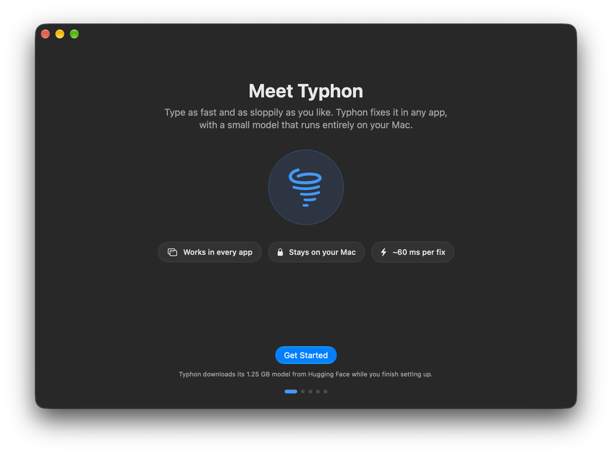
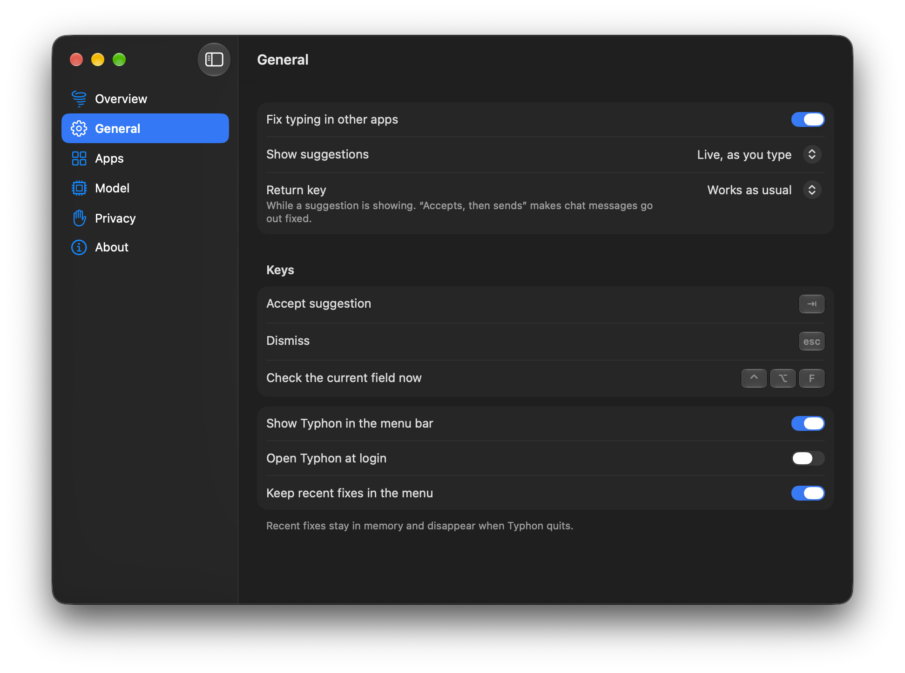

<p align="center">
  
</p>

<h1 align="center">Typhon</h1>

<p align="center">
  <b>Type fast and sloppy. Typhon fixes it, in every app on your Mac.</b><br>
  A small language model that runs entirely on your Mac, with no cloud and no telemetry.
</p>

<p align="center">
  
</p>

---

You type `cna u pikc up some milk on teh way hoem`. A small glass bubble appears next to your cursor showing **Can you pick up some milk on the way home?** with the changed words highlighted. Press **Tab** to take it, **Esc** to ignore it.

Typhon works in TextEdit, Notes and Safari today. Chrome, Messages, Slack and Discord are next on the test list (see [Supported apps](#supported-apps)). It fixes typos, missing spaces, homophones (*their / there / they're*), capitalization and punctuation. It fixes the whole sentence, not one word at a time, and replaces only the words that changed.

## Highlights

- **Fast.** About 60–80 ms per fix on Apple silicon (measured on an M5), using speculative decoding with a small drafter model. From the last key-up to the suggestion on screen takes about 230 ms.
- **Local.** The model runs on your Mac with [MLX](https://github.com/ml-explore/mlx-swift). What you type never leaves the machine, is never written to disk, and is never logged.
- **Everywhere.** Uses the macOS Accessibility API, so it isn't tied to one app. Wakes up the accessibility trees of Chromium and Electron apps when needed.
- **Careful.** Skips password fields, secure input and password managers. Apps can be turned off one by one. Return is never captured unless you ask for it.
- **Live.** Suggestions update as you type, or only when you pause; you choose in Settings.
- **Native.** SwiftUI and AppKit, built for macOS 26.

<p align="center">
  
  
</p>

## Install

1. Download the latest `Typhon-x.y.z.dmg` from [Releases](../../releases) and drag Typhon into Applications.
2. Typhon isn't notarized yet. The first time you open it, **right-click Typhon → Open**, then confirm. On recent macOS versions you may instead need **System Settings → Privacy & Security → Open Anyway**.
3. Follow the short setup: a live demo, Accessibility permission (with a drag-and-drop helper that continues on its own once access is granted), and the model download.

Requirements: a Mac with Apple silicon, running macOS 26 or later. About 1.3 GB of disk space for the model and about 1 GB of memory while running.

## How it works

```
 keystroke ─▶ event tap notices a pause (110 ms live / 350 ms "on pause")
            ─▶ read the focused field via AX: value, selection, caret bounds
            ─▶ pick the sentences around the caret (TextScope)
            ─▶ Typhon-1.2B on MLX: "Polish: {text}\nOut: " → greedy decode
               (a DSpark drafter guesses 4 tokens per step; Typhon checks them in one pass)
            ─▶ word diff ─▶ glass panel at the caret
 Tab        ─▶ smallest word-aligned edit, re-located against the current text
            ─▶ applied via AX (verified), or keyboard selection + paste (clipboard restored)
```

- **Model:** [Typhon-1.2B](https://huggingface.co/dennny123/Typhon-1.2B), fine-tuned from [Liquid AI LFM2.5-1.2B](https://huggingface.co/LiquidAI), a hybrid of short convolutions and attention. The app uses the [MLX 4-bit build](https://huggingface.co/dennny123/Typhon-1.2B-MLX-4bit) (0.66 GB). It is downloaded on first launch, pinned to an exact revision, SHA-256 verified, and resumable. It's stored in `~/Library/Application Support/Typhon`, never bundled in the app.
- **Inference:** [mlx-swift-lm](https://github.com/ml-explore/mlx-swift-lm), which supports LFM2 and its speculative-decoding cache rollback. The model stays loaded and warm. Only one request runs at a time, and a newer request cancels an older one at the next token.
- **Turbo mode:** Typhon's DSpark drafter (`dspark/` in the model repo) is loaded, quantized to 4-bit at load time, and used for speculative decoding. On the test set its output is identical to plain greedy decoding (10/10 in our Swift run), at about half the time per fix.
- **Accepting a fix** edits only the words that changed. It re-finds them in the field's current text, so anything you typed in the meantime is left alone. It uses a verified Accessibility edit in native apps, and real Shift+Arrow selection followed by paste in web views and Electron apps, which report Accessibility edits they never perform. It checks the selection before pasting, never pastes blind, and restores your clipboard afterwards.

| Speed (M5, Release) | median per fix | p90 |
|---|---|---|
| Plain greedy | 103 ms | 126 ms |
| Turbo (DSpark drafter, 4 guesses/step) | 58 ms | 70 ms |
| Harder, longer messages, Turbo | 79 ms | 103 ms |

## Supported apps

See [docs/COMPATIBILITY.md](docs/COMPATIBILITY.md) for details and per-app quirks.

| App | Suggestions | Tab replaces text | Notes |
|---|---|---|---|
| TextEdit | ✅ | ✅ (Accessibility) | Verified |
| Notes | ✅ | ✅ (Accessibility) | Verified |
| Safari | ✅ | ✅ (keyboard + paste) | Verified |
| Chrome | ✅ seen once | ⚠️ in progress | Accessibility wake-up via `AXEnhancedUserInterface`; not reliable yet |
| Messages, Slack, Discord | — | — | Not yet tested |
| Terminal, iTerm, Ghostty, Warp | off by default | — | Tab is shell completion there; can be turned on per app |
| Password managers, password fields | never | — | Always skipped |

## Privacy

- Inference is 100% on-device. The only network requests are the one-time model download from huggingface.co and, in release builds, a Sparkle update check against this repo's GitHub releases.
- No analytics, no crash reporting, no telemetry.
- What you type is never written to disk or to logs. "Recent fixes" live in memory and disappear when Typhon quits; you can turn them off.
- Secure text fields, secure keyboard input and password managers are always skipped.

## Build from source

You need Xcode 26 or later (full Xcode, not just the command-line tools, because MLX compiles Metal shaders) and an Apple silicon Mac.

```bash
git clone https://github.com/dennisimoo/typhon.git && cd typhon
open Typhon.xcodeproj          # or regenerate it: brew install xcodegen && xcodegen
```

Then build and run the **Typhon** scheme. From the command line:

```bash
xcodebuild -project Typhon.xcodeproj -scheme Typhon -configuration Release \
  -skipMacroValidation -skipPackagePluginValidation build
scripts/build-release.sh       # builds dist/Typhon-<version>.dmg (needs: brew install create-dmg)
```

Local builds are ad-hoc signed by default. macOS ties the Accessibility permission to the code signature, so with ad-hoc signing you'll need to grant it again after each rebuild. To avoid that, set a stable signing identity in `Config/Local.xcconfig` (git-ignored):

```
CODE_SIGN_IDENTITY = <your identity SHA-1 or name>
```

**Tools:** `typhon-bench <model-dir> [ref.json]` reports per-fix latency and can compare output against a reference.

**Releases:** push a tag such as `v1.0.0`. [`release.yml`](.github/workflows/release.yml) builds the app, packages the DMG, and drafts a GitHub release with a Sparkle appcast. Add a `SPARKLE_PRIVATE_KEY` repository secret to sign updates.

## Project layout

```
Typhon/            the app (SwiftUI + AppKit)
  Accessibility/   reading fields, caret location, app quirks, applying edits
  Input/           the keyboard event tap
  Suggestions/     the pipeline: pause → model → panel → accept
  Panel/           the floating glass suggestion panel
  Main/ Menu/ Settings/ Onboarding/
TyphonCore/        Swift package: engine, model download, diff, text scope, smart edits, bench CLI
scripts/           icon, DMG background, release build
```

## Credits

- **Typhon** (the app and the model) was made by [dennisimoo](https://github.com/dennisimoo). The model is on Hugging Face as [dennny123/Typhon-1.2B](https://huggingface.co/dennny123/Typhon-1.2B).
- [**Liquid AI LFM2.5**](https://www.liquid.ai/) is the base model and the DSpark drafter design. The model weights are under the [LFM Open License v1.0](https://huggingface.co/LiquidAI/LFM2.5-1.2B-Instruct/blob/main/LICENSE).
- [**MLX**](https://github.com/ml-explore/mlx-swift) and [**mlx-swift-lm**](https://github.com/ml-explore/mlx-swift-lm) by Apple's ML research team.
- [**swift-transformers**](https://github.com/huggingface/swift-transformers) by Hugging Face, for tokenization.
- [**PermissionFlow**](https://github.com/jaywcjlove/PermissionFlow) by jaywcjlove, for the System Settings deep links and the drag-the-app helper.
- [**Sparkle**](https://sparkle-project.org) for updates.
- Patterns studied (ideas, no code copied):
  - [KeyType](https://github.com/johnbean393/KeyType) (MIT): caret geometry fallbacks and Electron/Chromium accessibility wake-up.
  - [Jot](https://github.com/google-gemini/jot-gemini-transcribe-macOS) (Apache-2.0): verified insertion and clipboard-safe paste.
  - [Maccy](https://github.com/p0deje/Maccy) and [Rectangle](https://github.com/rxhanson/Rectangle) (MIT): panel and permission-flow patterns.
  - [WritingTools](https://github.com/theJayTea/WritingTools) (GPL, ideas only): inspiration for system-wide writing help.

## License

The app code is under the [MIT License](LICENSE). The Typhon model weights are distributed separately under the [LFM Open License v1.0](https://huggingface.co/dennny123/Typhon-1.2B-MLX-4bit/blob/main/LICENSE).
